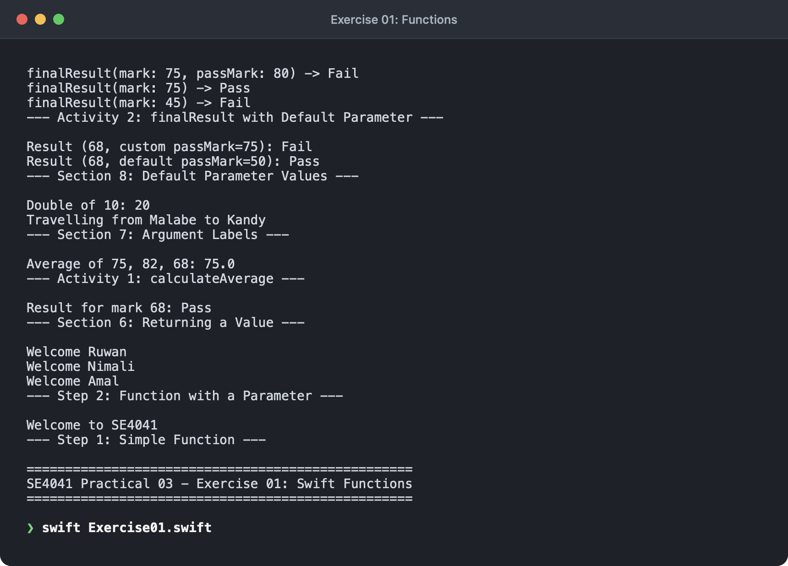
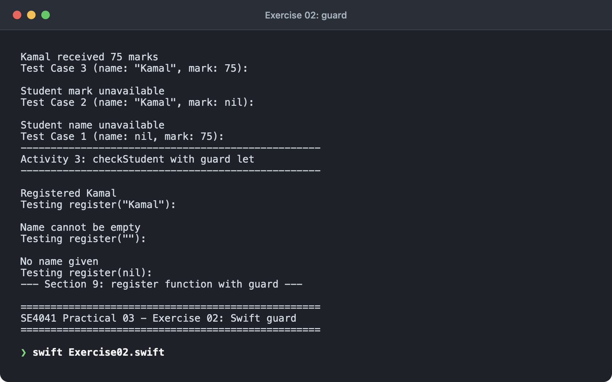
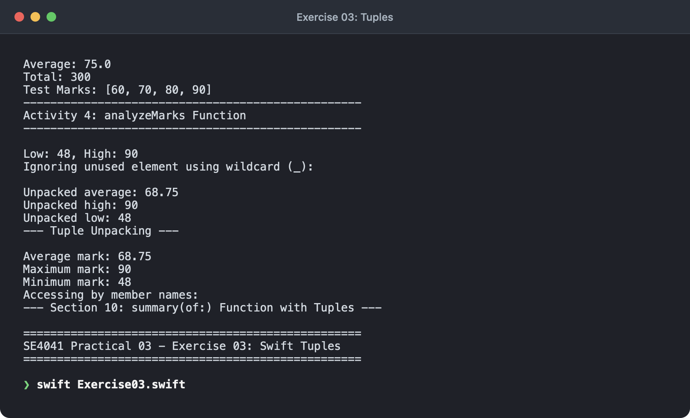
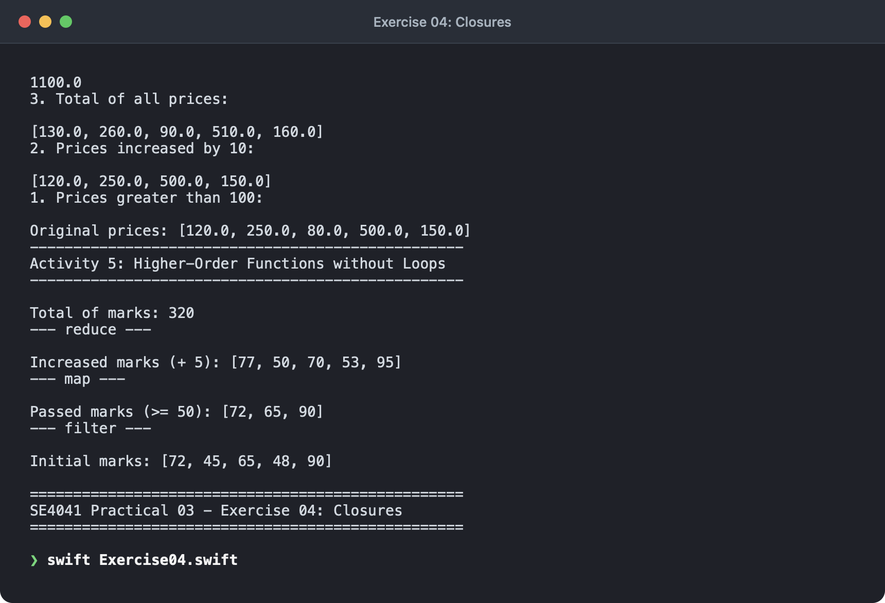
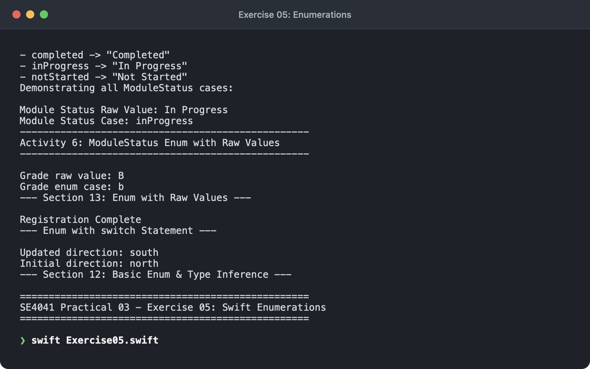
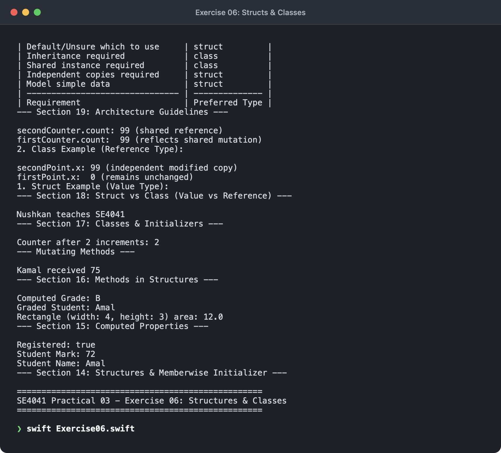
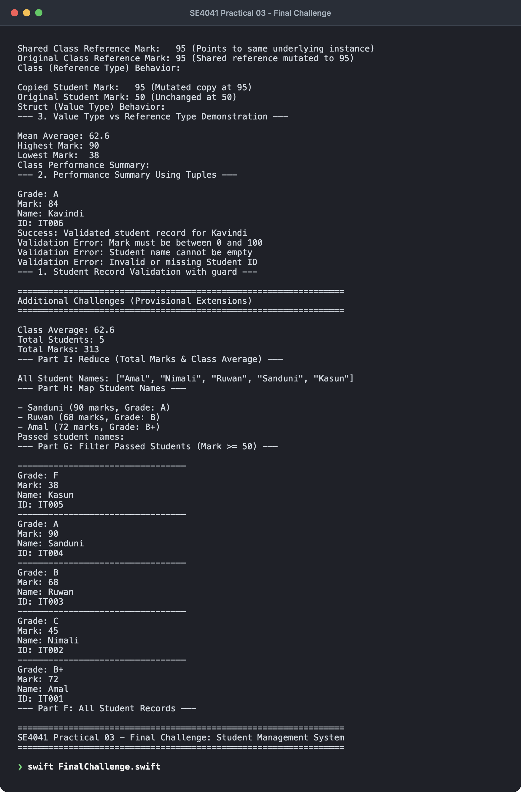

# SE4041 – Practical 03 – Functions, Enums, Structs & Classes in Swift

- **Student Name:** Jayasundara R.K.M.J.Y
- **Student ID:** IT22136374
- **Module:** SE4041 – Mobile Application Design & Development
- **Practical:** Practical 03 (Lab 03)
- **Environment Used:** Swift 5.9+ / Xcode Playground / macOS

---

## 1. Overview & Learning Objectives

This repository contains solutions, implementations, and execution evidence for **SE4041: Practical 03**. In this practical, core Swift concepts are explored to organize code into reusable, modular, and performant components.

### Core Concepts Covered:
- **Functions:** Definition, parameters, return types, argument labels, and default parameter values.
- **Early Exit with `guard`:** Safe optional unwrapping, input validation, and early function termination.
- **Tuples:** Grouping multiple values, named tuple elements, tuple decomposition/unpacking, and wildcards.
- **Closures & Higher-Order Functions:** Trailing closure syntax, `$0` / `$1` shorthand arguments with `map`, `filter`, and `reduce`.
- **Enumerations:** Distinct case modeling, pattern matching with `switch`, and raw values.
- **Structures:** Stored properties, memberwise initializers, computed properties, and `mutating` methods.
- **Classes:** Reference types, custom initializers (`init`), and shared state.
- **Value vs. Reference Types:** Memory semantics, deep copying (structs) versus shared instance references (classes).
- **Integrated Final Challenge:** A complete **Student Management System** leveraging enums, structs, computed properties, filtering, mapping, reducing, and early validation.

---

## 2. Repository Structure

| File | Description | Screenshot Evidence |
| :--- | :--- | :--- |
| [`Exercise01.swift`](Exercise01.swift) | Functions: parameters, return values, argument labels, default parameter values | [`Ex01.png`](screenshots/Ex01.png) |
| [`Exercise02.swift`](Exercise02.swift) | Early validation using `guard` and optional binding (`guard let`) | [`Ex02.png`](screenshots/Ex02.png) |
| [`Exercise03.swift`](Exercise03.swift) | Multiple return values using named Tuples and tuple unpacking | [`Ex03.png`](screenshots/Ex03.png) |
| [`Exercise04.swift`](Exercise04.swift) | Functional programming with closures: `filter`, `map`, and `reduce` | [`Ex04.png`](screenshots/Ex04.png) |
| [`Exercise05.swift`](Exercise05.swift) | Enumerations: custom cases, switch pattern matching, and String raw values | [`Ex05.png`](screenshots/Ex05.png) |
| [`Exercise06.swift`](Exercise06.swift) | Structures, computed properties, mutating methods, classes, and Value vs. Reference types | [`Ex06.png`](screenshots/Ex06.png) |
| [`FinalChallenge.swift`](FinalChallenge.swift) | Student Management System: Grade enum, Student struct, computed grade, `map`, `filter`, `reduce`, and validation | [`02-final-challenge.png`](screenshots/02-final-challenge.png) |
| [`screenshots/`](screenshots/) | Terminal output captures for all exercises and final challenge | [`01-exercises.png`](screenshots/01-exercises.png)<br>[`02-final-challenge.png`](screenshots/02-final-challenge.png) |

---

## 3. Detailed Practical Exercises

### Exercise 01 – Swift Functions
- **File:** [`Exercise01.swift`](Exercise01.swift)
- **Key Features:**
  - **Basic Function:** Declaring and calling `greet()`.
  - **Parameterized Function:** `greetStudent(name:)` accepting dynamic values.
  - **Return Values:** `grade(for mark: Int) -> String` returning `"Pass"` or `"Fail"`.
  - **Activity 1:** Implemented `calculateAverage(_ num1: Double, _ num2: Double, _ num3: Double) -> Double` returning `75.0` for inputs `75`, `82`, and `68`.
  - **Argument Labels:** External labels (`from:`, `to:`) for natural readability, and label omission using wildcard `_` (`double(_ number: Int)`).
  - **Default Parameters & Activity 2:** `finalResult(mark: Int, passMark: Int = 50) -> String` demonstrating fallback defaults and overridden call sites.

```swift
func calculateAverage(_ num1: Double, _ num2: Double, _ num3: Double) -> Double {
    return (num1 + num2 + num3) / 3.0
}

func finalResult(mark: Int, passMark: Int = 50) -> String {
    return mark >= passMark ? "Pass" : "Fail"
}
```



---

### Exercise 02 – Early Exit with `guard`
- **File:** [`Exercise02.swift`](Exercise02.swift)
- **Key Features:**
  - Fast-failing validation using `guard let` and boolean conditions (`!name.isEmpty`).
  - Unlike `if let`, unwrapped values with `guard let` remain in scope for the remainder of the function body.
  - **Activity 3 (`checkStudent(name:mark:)`):**
    - Verifies optional student name; if `nil`, prints `"Student name unavailable"` and terminates.
    - Verifies optional mark; if `nil`, prints `"Student mark unavailable"` and terminates.
    - Prints `\(name) received \(mark) marks` on valid input.

```swift
func checkStudent(name: String?, mark: Int?) {
    guard let studentName = name else {
        print("Student name unavailable")
        return
    }
    guard let studentMark = mark else {
        print("Student mark unavailable")
        return
    }
    print("\(studentName) received \(studentMark) marks")
}
```



---

### Exercise 03 – Tuples & Multi-Value Returns
- **File:** [`Exercise03.swift`](Exercise03.swift)
- **Key Features:**
  - Grouping heterogeneous values without defining a full struct/class.
  - Named tuple elements: `(minimum: Int, maximum: Int, average: Double)`.
  - Tuple unpacking (`let (low, high, avg) = summary(...)`) and partial decomposition with `_`.
  - **Activity 4 (`analyzeMarks(_:)`):** Computes total mark and average for `[60, 70, 80, 90]`, returning `Total: 300` and `Average: 75.0`.

```swift
func analyzeMarks(_ marks: [Int]) -> (total: Int, average: Double) {
    let total = marks.reduce(0, +)
    let average = marks.isEmpty ? 0.0 : Double(total) / Double(marks.count)
    return (total: total, average: average)
}
```



---

### Exercise 04 – Closures, `map`, `filter`, and `reduce`
- **File:** [`Exercise04.swift`](Exercise04.swift)
- **Key Features:**
  - Trailing closure syntax and shorthand argument naming (`$0`, `$1`).
  - **`filter`:** Selects elements matching a predicate (`marks.filter { $0 >= 50 }`).
  - **`map`:** Transforms each item without mutating original storage (`marks.map { $0 + 5 }`).
  - **`reduce`:** Aggregates all elements into a single accumulator (`marks.reduce(0, +)`).
  - **Activity 5 (Higher-Order Functions without loops):**
    - Filter prices greater than 100: `[120.0, 250.0, 500.0, 150.0]`
    - Map prices increased by 10: `[130.0, 260.0, 90.0, 510.0, 160.0]`
    - Reduce total prices: `1100.0`

```swift
let prices = [120.0, 250.0, 80.0, 500.0, 150.0]
let expensive = prices.filter { $0 > 100 }
let increased = prices.map { $0 + 10 }
let total = prices.reduce(0) { $0 + $1 }
```



---

### Exercise 05 – Swift Enumerations
- **File:** [`Exercise05.swift`](Exercise05.swift)
- **Key Features:**
  - Modeling a closed set of choices (`Direction`, `Status`).
  - Exhaustive pattern matching with `switch` statements without needing `default`.
  - Raw values (`Grade: String` with cases `"A"`, `"B"`, `"C"`, `"F"`).
  - **Activity 6 (`ModuleStatus`):**
    - Raw value enum with cases `"Not Started"`, `"In Progress"`, and `"Completed"`.

```swift
enum ModuleStatus: String {
    case notStarted = "Not Started"
    case inProgress = "In Progress"
    case completed = "Completed"
}

let currentStatus = ModuleStatus.inProgress
print(currentStatus.rawValue) // Prints "In Progress"
```



---

### Exercise 06 – Structures, Classes & Reference Semantics
- **File:** [`Exercise06.swift`](Exercise06.swift)
- **Key Features:**
  - **Structures:** Automatic memberwise initializer and stored properties.
  - **Computed Properties:** Dynamically calculated properties (`Rectangle.area`, `GradedStudent.grade`).
  - **Methods & `mutating`:** Methods altering struct state must be declared with `mutating`.
  - **Classes:** Reference types with custom designated initializer `init(name:module:)`.
  - **Value vs. Reference Distinction:**
    - Structs are **value types**: assignment creates an independent copy. Mutating `secondPoint.x` does **not** affect `firstPoint.x`.
    - Classes are **reference types**: assignment shares the same instance in heap memory. Mutating `secondCounter.count` immediately mutates `firstCounter.count`.

```swift
// Struct Example (Value Type)
struct Point { var x = 0 }
var firstPoint = Point()
var secondPoint = firstPoint
secondPoint.x = 99
// firstPoint.x remains 0, secondPoint.x is 99

// Class Example (Reference Type)
class CounterClass { var count = 0 }
let firstCounter = CounterClass()
let secondCounter = firstCounter
secondCounter.count = 99
// Both firstCounter.count and secondCounter.count are 99
```



---

## 4. Final Practical Task – Student Management System

- **File:** [`FinalChallenge.swift`](FinalChallenge.swift)

### Architectural Components:
1. **Part A – `Grade` Enum:**
   Raw-value enumeration covering `"A"`, `"A-"`, `"B+"`, `"B"`, `"B-"`, `"C+"`, `"C"`, `"C-"`, and `"F"`.
2. **Part B – `Student` Struct:**
   Stores `studentID: String`, `name: String`, and `mark: Int`.
3. **Part C – Computed `grade` Property:**
   Uses exhaustive range matching with a `switch` statement:
   - `80...100` ➔ `A`
   - `75..<80`  ➔ `A-`
   - `70..<75`  ➔ `B+`
   - `65..<70`  ➔ `B`
   - `60..<65`  ➔ `B-`
   - `55..<60`  ➔ `C+`
   - `45..<55`  ➔ `C`
   - `40..<45`  ➔ `C-`
   - Below 40   ➔ `F`
4. **Part D – `displayDetails()` Method:**
   Prints formatted card with student ID, name, mark, and computed letter grade.
5. **Part E & F – Student Population & Iteration:**
   Initializes 5 student instances and iterates through them to display details.
6. **Part G – Filtering (`filter`):**
   Extracts passed students (`mark >= 50`). Note: a student with mark 45 receives grade `"C"` per grade bands, but is accurately filtered out by the `>= 50` condition.
7. **Part H – Mapping (`map`):**
   Transforms the student array into an array of names `["Amal", "Nimali", "Ruwan", "Sanduni", "Kasun"]`.
8. **Part I – Aggregation (`reduce`):**
   Computes the total marks (`313`) and outputs the exact class average: `62.6`.

### Additional Provisional Extensions:
- **`guard` Validation:** Validates non-empty ID, non-empty Name, and score range `0...100`.
- **Tuple Summary Function:** `summarizePerformance(of:)` returns `(minimum: Int, maximum: Int, average: Double)` with safe empty-collection handling.
- **Value vs. Reference Verification:** Concrete demonstration logging struct value isolation vs class reference mutation.



---

## 5. Knowledge Check (Section 20 Review)

| # | Question | Answer |
|---|:---|:---|
| 1 | **Why do we use functions?** | To eliminate duplicate code, organize logic into readable, self-contained units, and facilitate testing and reusability. |
| 2 | **What is a function parameter?** | A variable defined in a function signature that receives input values when the function is called. |
| 3 | **What does `-> String` mean?** | It denotes the return type arrow syntax, indicating that the function returns a `String` value. |
| 4 | **What is an argument label?** | An external label used when calling a function to make calls read like natural English sentences. |
| 5 | **What is a default parameter value?** | A pre-assigned fallback value that makes the argument optional at the call site. |
| 6 | **What is the purpose of `guard`?** | To validate preconditions early, unwrap optionals safely, and exit the function scope immediately if the condition fails. |
| 7 | **What is a tuple?** | A lightweight compound type that groups multiple values into a single compound value, often used to return multiple values. |
| 8 | **What does `filter` do?** | Iterates over a collection and returns a new collection containing only elements satisfying a Boolean condition. |
| 9 | **What does `map` do?** | Transforms every element in a collection using a given closure and returns the transformed collection. |
| 10 | **What does `reduce` do?** | Combines all elements of a collection into a single value by repeatedly applying an accumulator closure. |
| 11 | **What problem does an enum solve?** | Defines a type-safe, closed set of possible values, preventing invalid inputs and typos at compile time. |
| 12 | **What is a raw value?** | A predefined underlying value (such as `String`, `Int`, or `Character`) attached to an enum case. |
| 13 | **What is a struct?** | A user-defined value type that encapsulates stored/computed properties and methods with an automatic memberwise initializer. |
| 14 | **What is a stored property?** | A constant or variable stored as part of an instance of a struct or class. |
| 15 | **What is a computed property?** | A property that does not store a value directly; it calculates its value every time it is read using a getter. |
| 16 | **When is `mutating` required?** | When a method inside a `struct` or `enum` modifies one or more of its own stored properties. |
| 17 | **What is a class?** | A reference type blueprint that supports stored/computed properties, methods, custom initializers, and inheritance. |
| 18 | **What is the main difference between a struct and a class?** | Structs are **value types** (copied on assignment/passing), whereas classes are **reference types** (multiple variables point to the same memory instance). |

---

## 6. How to Run the Code

Run any of the Swift source files directly from the command line using the Swift interpreter/compiler:

```bash
# Execute individual exercises
swift Exercise01.swift
swift Exercise02.swift
swift Exercise03.swift
swift Exercise04.swift
swift Exercise05.swift
swift Exercise06.swift

# Execute the Final Challenge Student Management System
swift FinalChallenge.swift
```

---

## 7. Submission Checklist Verification

- [x] `Exercise01.swift` – Functions, parameters, return values, argument labels, and defaults.
- [x] `Exercise02.swift` – Early exit with `guard`, optional binding, and student validation.
- [x] `Exercise03.swift` – Tuples, named return values, unpacking, and wildcard usage.
- [x] `Exercise04.swift` – Closures with `filter`, `map`, and `reduce`.
- [x] `Exercise05.swift` – Enumerations, switch pattern matching, and raw values.
- [x] `Exercise06.swift` – Structs, computed properties, mutating methods, classes, and Value vs. Reference types.
- [x] `FinalChallenge.swift` – Complete Student Management System (Parts A through I + Provisional extensions).
- [x] `README.md` – Full documentation, code listings, architecture tables, and knowledge check answers.
- [x] `screenshots/` – Terminal output evidence images for all exercises and final challenge.
